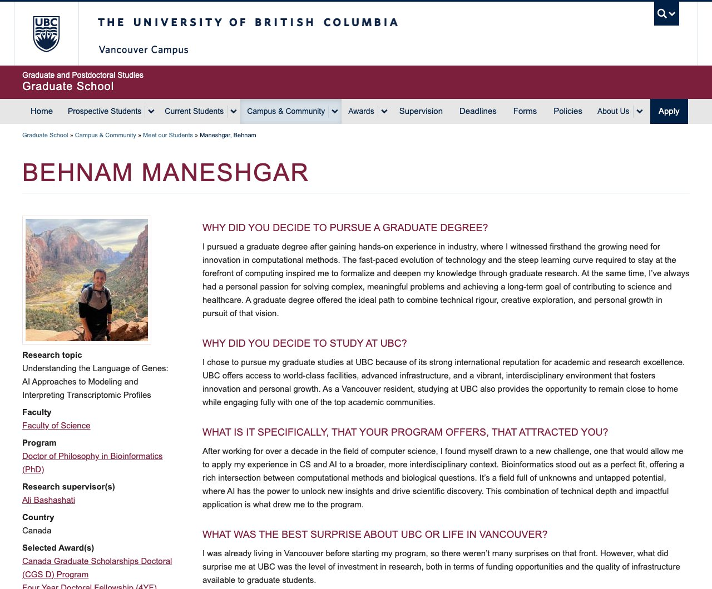

Excited to be highlighted in the UBC Graduate School's **Meet our Students**
series! In the profile, I share my thoughts on my path into graduate school and
my PhD research, *Understanding the Language of Genes: AI Approaches to Modeling
and Interpreting Transcriptomic Profiles*.

{: .w-shot-small}

After more than a decade in computer science and industry, I wanted to bring my
experience in AI to a new, more interdisciplinary challenge, and bioinformatics
was the perfect fit. In the profile, I talk about why I chose UBC, what drew me
to the program, and the advice I'd give new graduate students: coursework is only
part of the journey, and communication, networking and understanding how your
field works matter just as much.

Read the full story on the UBC Graduate School website:
