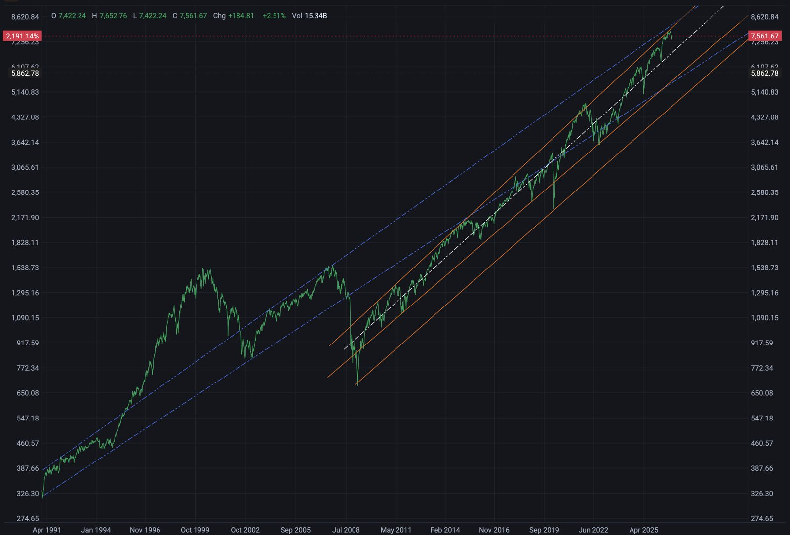

For the past six months, I expected a big crash to be just around the corner. We keep
hearing the same warnings: earnings are stretched, valuations are high, and the
S&P 500 is more concentrated in a handful of big tech companies than ever. But
when I looked at the history, the picture looked quite different.

The chart above is the S&P 500 since 1991, on a **log scale**. That's something
I learned only recently, and it changed how I look at markets. On a normal
chart, a 10% move at today's levels looks enormous next to a 10% move in the
1990s. On a log scale, equal percentage moves look the same size, so you can
finally compare different decades fairly. And for long-term growth, the log
scale is really all that matters.

Seen this way, the market looks surprisingly **linear**. The blue lines show the
channel it followed from the early 1990s through 2008. The orange lines show the
channel it has followed since the 2009 low, with the white line through the
middle. Even the big drops, like 2008, 2020 and 2022, look like dips that the
index recovered from, returning to its trend instead of breaking it.

That gives me a simple way to think about bubbles. Instead of reacting to every
headline, I can check whether the market is still following its trendline. If
it's running far above it, that's a warning sign. If it's moving along it, the
growth may be less of a bubble than it sounds.

## Why a crash is unlikely

Because of these lines. Over the last three decades, the market has kept coming
back to its long-term trend, through recessions, crises and a pandemic. Today's
level is still inside the channel, not breaking out far above it.

That said, we are on the **higher side** of the channel right now, close to its
upper edge. If the pattern holds, I'd expect the market to come down from here,
back toward the middle of the channel. To me, that looks more like a pullback
than a crash.

There's another detail worth noticing: near today's high, the **orange and blue
lines meet**. The faster channel since 2009 has caught up with the slower,
longer-term one. That could mean the market has been growing faster than its
long-run average, and that growth may slow down from here.

## Why a crash is still possible

Because this chart doesn't show what came before. It starts in 1991, and the
trend before that was very different. A pattern that held for thirty years is
not a law of nature, and markets have gone through long stretches where the
trend broke or flattened for years.

So I haven't stopped believing a crash *can* happen. I've just stopped assuming
one is coming, simply because the headlines say so.

I'll leave the rest of the analysis to you. Take a look at the chart and draw
your own lines.

*This is my personal view, not financial advice.*
